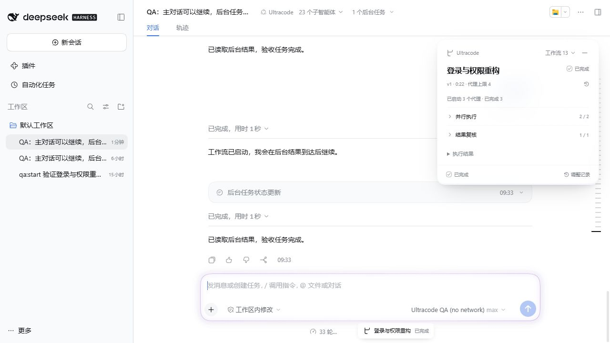

# Ultracode for DeepSeek Harness

为 DSH 添加多 Agent 工作流预设、固定悬浮进度卡片和输入框模式微光。模型与思考强度沿用 DSH 的独立选择，不强制最高强度。

社区插件，与 Anthropic、OpenAI 无隶属关系；不包含 Claude Code 的专有代码。



## 功能

- 选择 Ultracode 即授权编排：模型判断复杂任务并主动创建工作流，简单任务直接完成，无需重复要求。
- 1.3.0 保留 JavaScript 脚本编排，支持脚本文件、启动前校验、调整后复用已完成结果和会话恢复。
- 复杂任务在实现前启动工作流；标准模式与已有会话的切换和恢复仍保持隔离。
- 启动时动态继承当前标准预设，仅覆盖工作流编排策略、并发和总代理预算。
- 使用 DSH 原生工作流、子代理、后台任务和完成通知；后台任务结束后可唤醒主对话。
- 工作流卡片固定悬浮、可拖动和折叠，支持阶段、成员、执行结果和版本历史。
- 同一目标调整保留版本链，先结束旧执行再启动新版本；独立任务使用独立工作流。
- 切到 Ultracode 时，从输入框顶部正中播放开场流光；短暂停顿后淡入连续呼吸微光。切回其他模式清除，恢复已有会话不重播。

## 兼容与安装

已验证 DSH Desktop **0.2.1-rc.2**。声明支持 `>=0.2.1-rc.2 <0.3.0-0`，未来宿主接口变化仍需重新验证。

从本仓库的 Release 下载 `.tgz`，在 DSH 的插件安装入口选择该安装包。CLI 用户可用：

[下载 v1.3.0](https://github.com/Srelka/dsh-ultracode/releases/tag/v1.3.0)

```powershell
dsh plugin --profile web add ./srelka-dsh-ultracode-1.3.0.tgz
```

将 `web` 替换为实际使用的 profile。桌面端优先使用应用内插件管理入口。安装后完全退出并重新打开 DSH，在新会话的 Agent 预设中选择 **Ultracode**。

如果已经安装本地开发版 `@local/dsh-ultracode`，先通过 DSH 插件管理卸载该开发版，再安装本包，避免两个包同时注册同名预设。卸载插件不需要删除会话；本包沿用 `ultracode` 预设和历史标识。

当前宿主只允许空白会话切换预设，已有对话保留原模式。默认并发上限为 4，默认每个工作流总代理上限为 12，可调整但不超过 40。工作代理禁止继续递归委派。

## 配置

在 DSH 的用户覆盖层设置 `preset-ultracode`；覆盖该行时保留完整配置：

```yaml
- id: preset-ultracode
  name: '@srelka/dsh-ultracode/inherit'
  config:
    basePreset: standard
    maxConcurrentAgents: 4
    defaultAgentLimit: 12
    maxTotalAgents: 40
    replacementTimeoutMs: 30000
```

标准预设的修改在下次启动时继承，不做运行中热更新。详见 [设计与验证](docs/design-and-validation.md)。

## 开发与测试

使用与目标 DSH 运行时一致的 Node.js。安装依赖后，将 `ULTRACODE_TEST_RUNTIME` 指向具有 `node_modules` 的同版本 DSH 运行时目录，执行 `npm test`。该变量只供测试使用，插件通过宿主 Loader 获取原生接口。

只运行无需 DSH 依赖的模型和光效控制器测试：

```sh
node --test tests/model.test.mjs tests/composer-glow.test.mjs
```

运行模块已经是 JavaScript，不要求用户执行构建脚本。打包使用 `npm pack --ignore-scripts`。`private: true` 用于防止误发布到 npm，不影响 Git/安装包分发。

## 限制

任务拆分和结果质量取决于实际模型。进程重启后保留工作流历史及已完成结果；恢复时从头运行脚本并复用有效前缀，不恢复运行中的 JavaScript 指令位置。工具参数格式错误仅在本步尚未执行工具时最多重试两次，不能保证所有模型永不输出错误。系统开启减少动态效果时只保留静态模式边缘。

## License

MIT，见 [LICENSE](LICENSE)。保留已有版权与许可声明。
