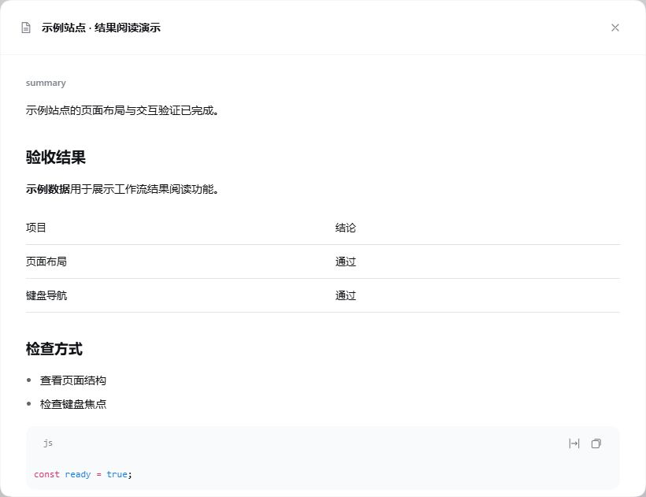

# 设计与验证

## 1.6.0 按需选择模型与思考强度

默认继承不变。只有用户明确提出选择时，编排代理查询 `ultracode_models`，为相关 `agent()` 调用设置 `provider`、`model`、`reasoning_effort`。仅改强度时省略模型字段；更换模型而未指定强度时，由新模型提供默认值。这是模型遵循的编排规则，不是自然语言授权识别器。

继续使用启动时加载的原生 PTC 引擎。在仅供该引擎使用的子代理服务作用域中，增加创建前的路由校验与参数适配。当前宿主的 PTC 传输只认识 provider/model，因此独立强度通过内部 model 封装传输，在原生子代理创建前解包；子代理描述符和真实模型请求只保存实际模型与强度。未修改宿主文件、全局服务、标准模式或主对话模型，未增加依赖。

检查点键仍由原始提示和选项生成；修改模型或强度使对应调用及后续调用重新执行。旧检查点和历史格式不变；原生子代理描述符承担冷恢复，界面和历史投影未改动。查询只返回公开模型元数据和当前选择，不返回配置凭据；模型/强度无效时在创建子代理前失败，不回退。

验收：74 项自动化测试通过，包含安装的原生 PTC guest/host 协议、作用域隔离、模型发现、不同模型默认强度、无效选择拒绝、取消、检查点失效及预设切换。真实 DSH 0.2.1-rc.3 中，DeepSeek Flash 主代理以 High 编排两个并行代理，分别实际使用 High 与明确指定的 Off；另一独立工作流实际使用 DeepSeek V4 Pro 默认 High，主对话仍为 Flash / High。查询改进后只调用一次工具即可读取当前选择，无需读取配置。

确定性适配器另验收跨提供方、并行不同强度、修改强度后仅复用未变前缀、不支持强度时无新增代理且不回退、重启后四份结果全部复用和零新增代理、子代理冷恢复后的真实请求与持久化描述符一致、切回标准恢复原生工具。跨提供方验证使用测试适配器，不冒充多家真实服务验收。重连时宿主短暂记录会话绑定错误，恢复后会话、成员跳转与继续运行均成功。只读重放 2,698 条既有事件及八个版本/语言视图，未修改会话数据；客户端和历史投影源文件保持不变。

## 1.5.0 进度书签

卡片保留固定悬浮、拖动和顶部收起入口，阶段区域改为进度书签。当前名称与节点对齐，前序阶段显示名称和完成数。默认选择运行阶段，其次为异常阶段；手动选择后保持固定，可通过“跟随进度”恢复自动选择。选择按会话与工作流版本保存，旧的折叠偏好不会改写历史事件。

主卡片仅显示少量重点成员，优先呈现异常和运行项。完整清单、成员详情、版本历史和执行结果在独立阅读视图里呈现，保留停止二次确认、子代理跳转、错误原文、复用依据和旧版本返回入口。阶段较多时可通过选择器访问所有阶段；低高度窗口保留阶段导航与完整清单入口。

进度条使用彗星微光、末端羽化和少量光屑，比例仍按已完成成员计算，复用的成功结果计入完成数。仅在工作流运行且已有实际完成进度时播放，结束后静止；减少动态效果时不播放流光、粒子和阶段过渡。

68 项自动化测试通过，覆盖手动选择与自动跟随、大量阶段/成员访问、异常优先展示、旧偏好兼容和终态停止动效。DSH 0.2.1-rc.3 隔离环境使用虚构演示任务验收启动、途中调整、后台完成通知、历史恢复、成员详情、停止确认和结果阅读。读取 2,652 条既有事件检查历史兼容性，八个版本/语言视图保持可读，未修改会话数据。执行、提示词、继承和恢复等 11 个核心文件保持不变；本次不重新评估真实模型的规划能力。

公开截图和示例只使用虚构任务，不包含真实会话、项目资料或本机路径。v1.4.0 的旧演示截图已从其公开提交和安装包中移除，功能代码保持不变。

## 1.4.0 界面整理

保留可拖动的悬浮卡片。收起入口移至宿主 `conversation.session.header.actions`，展开时不重复显示入口；底部不再显示横条。窄屏入口仅保留状态图标和数量。卡片根据当前会话输入区的边界限制位置与高度，主体独立滚动，顶部拖动和底部操作保持可用。标题最多两行，完整内容可悬停查看；代理预算收进元信息提示。进度包含已完成的复用成员，不作为剩余耗时估算。

去掉重复的总体警告框与完成状态，保留总状态、成员原因、展开后的错误详情和已有操作。没有新增重跑功能，没有改变工作流、恢复和检查点协议，也没有改动预设提示词。

结果入口只显示两行正文预览；点击打开原生模态阅读器，复用宿主 MarkdownText 呈现段落、列表、表格和代码。JSON 对象保留字段名，数组显示列表；后台附加的状态与已知异常尾注仅在 JSON 能完整解析时从阅读正文分离，原文始终保留。普通文本、格式不完整的数据不会被猜测修复。阅读器显示的是原有投影保存的输出，不重新读取或补齐之前被截断的记录。

验收：63 项自动化测试通过；读取本机既有 1,944 条历史事件，四个历史版本/语言视图可展开结果且不改变投影。执行、提示词、派生、恢复等 11 个核心源文件与上一版一致（排除换行形式）。界面验收使用本机官方 DSH 0.2.1-rc.3 的隔离配置和确定性测试适配器，覆盖并行启动、期间调整、完成通知、二次确认停止、错误原因与子代理跳转、多工作流与历史版本、刷新恢复、鼠标拖动和键盘复位、浅/深色、529px 窄屏、报告表格/代码/原文、Escape 与焦点返回。此次没有重新开展真实模型规划能力测试；先前真实模型验收记录保留如下。自动化原生接口回归仍使用已保留的 0.2.1-rc.2 测试运行时。

## 1.3.3 结构精简

工作流卡片拆为选择菜单、版本历史、阶段列表和成员详情，保持原有 DOM、CSS、文案与交互。成员原因在单行渲染中只计算一次，成员统计集中计算；中断状态统一更新仍在运行的成员，已结束成员保持原样。删除未使用的图标、文案与遍历字段。提示词、工具参数、执行核心、事件格式和投影版本均保持不变。

仓库作为唯一源码；`scripts/prepare-local.mjs` 按包的发布文件清单生成本地标识版本，并支持只读一致性检查。发布包直接从仓库打包，取消旧的候选源码到发布源码的反向复制和固定旧版本字符串替换。生成时保留二进制图片原字节，不复制测试、开发脚本、依赖和环境配置。

结构回归：原有 52 项测试及新增 6 项交互/分发测试通过；中英文、8 种状态、6 类展开/历史场景共 96 组渲染树与改前一致，CSS 与提示词原文一致。实际旧会话 1,694 条记录逐事件重放与改前一致，不改写原会话。

DSH 实际页面复验了历史原因/错误详情、版本选择、阶段与成员展开、拖动及 Home 复位、折叠、停止二次确认、打开子代理和模式光效。真实 DeepSeek-V4.1-Flash / High 验收中，两个代理串行实现与独立测试，主代理派发后让出轮次，期间独立问答不取消工作流；完成通知唤醒后仅读取结果并汇总。样例 19 项测试通过：DSH 沙箱内因普通测试进程启动报 spawn EPERM，改用同进程 node:test；沙箱外普通 node --test 另行复验也是 19/19。本次是真实的显式工作流验收，最初的小范围任务被模型判断为直接处理，未把它算成复杂任务自动编排通过。

## 实现边界

启动时读取宿主 Loader 的最终 `standard` 声明，保留条件配置和模块解析位置，生成独立 Ultracode 预设。覆盖工作流编排、并发和预算，以及普通委派入口；原生执行器仍保留，标准预设不变。不做运行中热更新。

输入框仍使用原生 `conversation.input.overlay`，保留开场流光与呼吸微光。1.4.0 工作流入口改用会话顶部槽位，悬浮、拖动、折叠和历史功能保留。宿主变更槽位、会话根节点、`data-composer-seat` 或 `data-composer-card` 锚点时需要复验。开场 1.8 秒，无光间隔 0.35 秒，微光淡入 1.1 秒，呼吸周期 5.6 秒；减少动态效果时保留静态边缘。

## 1.3.2 主代理统筹与独立交办

主代理负责规划、契约、脚本、调整与汇总；工作流承担实现、整合、测试和修复。成功派发调用宿主 `concludeTurn()` 结束当前轮次，后台任务继续执行，完成后由原生通知唤醒。启动失败不结束轮次，允许纠错；缺少该宿主接口时在启动前报错。

用户另行交办简单、独立的查询或文档时，主代理直接完成，原工作流继续运行。涉及在执行代理负责的文件时，先停止并等待原执行结束，再调整分工或按明确要求接管；不设置会阻止独立任务的全局写入锁。分工与文件归属由模型遵循规则判断，不是文件锁或越权防护。

结束轮次不取消已经提交的同一步工具调用或新到达的用户消息，因此策略要求工作流派发为本轮最后动作，不与实现操作混批。需要阶段性决策时采用前后相继的工作流；本版没有新增每个阶段自动唤醒。
后台完成后主代理读报告和必要产物，缺失的测试与修复继续分派，不自行重复实现或测试。首次真实模型验收发现它仍会在收尾时亲自修复测试入口，因此进一步明确了这条边界；不能把该首次验收算成完全通过。

成员异常展示简短原因，展开提供下一步建议、错误码及原始原因。成功的原生 interrupt_agent 记录可还原“被主代理中止”；单纯的上级取消信号不会擅自归因于主代理决策。模型格式错误、认证、限流、连接、输出上限和原因缺失分别显示。诊断通过宿主 sessionQuery.observeSession 读取，仅读取最终轮次原因，不启动子代理；不可读取时明确显示原因未记录。诊断使用可忽略的插件记录保存，投影版本升至 5，旧历史重放兼容。

脚本正常返回但有成员未正常完成时，卡片显示“已结束，有异常”，并在后台结果中提示未完成成员。保留原生脚本执行状态，避免把脚本结束当作全部任务成功；也不自动把已由脚本处理的单次失败认定为整个任务失败。

验收：52 项插件测试通过；真实 DeepSeek-V4.1-Flash 1017 / High 验证派发后让出轮次、运行中独立文档、完成通知唤醒、标准隔离和旧会话恢复。最终的实现与独立复核复验中，主代理只写工作流脚本；回调无业务写入、无自行运行测试。生成账单项目在工作区 TEMP/TMP 下另行执行 150 项测试全部通过。模型格式错误与主动中止由独立故障适配器注入，验证原因、建议、原始详情、整体异常提示及跨重启保留；不冒充真实模型故障。

## 1.3.1 状态图标

修复运行图标静止为缺口圆环的问题，并用 SVG 的圆形轨道和圆头弧线代替 CSS 边框。外层 12×12 布局固定，只有 SVG 以 900ms 周期旋转。减少动态效果时显示静态完整圆环。实际 DSH 页面验证圆弧结构、旋转与尺寸，以及完成后恢复静态对勾；减少动态效果分支经 CSS 审查，未修改操作系统设置。仅改客户端显示，不改变任务或工作流执行。

## 1.3.0 脚本编排、调整与恢复

保留 JavaScript 动态工作流，参考 [Claude Code Dynamic Workflows](https://code.claude.com/docs/en/workflows)，不把它替换为普通聊天式 Agent Teams。主代理先检查和明确契约，再编写并启动脚本；工作代理负责有边界的实现和独立验证。简单任务直接处理。脚本应保存在用户允许的任务目录中，完成后保留供恢复和编辑。

推荐使用 `workflow({script_path, agent_limit})`。脚本第一条语句为 `export const meta = {...};`，其后使用原生 `agent`、`parallel`、`pipeline`、`phase`、`log` 和 `args`。Acorn 只解析元数据字面量，不执行元数据表达式；文件读取使用宿主文件系统和工作目录，文件上限 256 KiB。旧的内嵌 `script + meta` 调用仍兼容。

同一任务调整使用 `workflow_id`、`expected_revision`、`change_reason`。新脚本与参数先校验，旧执行结束并清理后才启动新版本。`resume:true` 按代理调用顺序复用上一版已成功完成的连续前缀；首个提示或参数变化、失败、缺失结果及后续调用重新执行。模型路由变化也会使缓存失效。旧结果不再适用时应使用 `resume:false`。每次执行的 `agent_limit` 限制新增代理数，复用结果不计为新启动；它不是跨全部历史版本累计的预算。

单个完成结果超过 100,000 字节时不保存为检查点。恢复是重新执行脚本并重放有效结果，不是恢复 JavaScript 指令位置，也不让被终止的进程继续运行。界面保留版本链，分别展示新启动成员与复用结果。原生子代理编号会在每次执行时重新计数，主代理应通过 `ultracode_workflows` 判断逻辑成员，不能仅凭编号断言任务重复。

历史投影继续读取原生事件；完成检查点通过宿主 `appendPluginRecord` 保存为可忽略的插件记录，不写入未知的必需事件。旧版历史保持兼容，恢复时已不存在的执行标记为中断。插件会话记录属于宿主实验性接口，后续更新仍需兼容性复验。

派生预设禁用普通 `subagent` 工具注册，包括模型设置生成的实例级入口；保留原生子代理执行器和后台任务服务，委派统一由工作流管理。运行中的工作流 `job_output` 查询立即返回，主对话结束轮次后由完成通知唤醒；普通命令任务仍保留原等待规则。

仅对“工具输入不是合法 JSON”的 MALFORMED_RESPONSE，在本步没有工具执行时最多重试两次。同一步共用一个重试链编号，采用宿主原生重试事件；不猜测修补 JSON、不重复已提交的工具。连续错误仍如实失败。

生产依赖为 Acorn 8.19.0 和 Zod 4.6.6。原生工具、作用域及会话记录接口通过宿主 Loader 获取，不打包旧 DSH 运行时。声明范围 `>=0.2.1-rc.2 <0.3.0-0`，实际验收版本为 0.2.1-rc.2，不能保证范围内所有未来版本免维护。

## 1.3.0 验收

- Windows、DSH Desktop 0.2.1-rc.2，同版本官方 CLI 的独立配置环境；45 项自动化测试通过，依赖审计为零漏洞。
- 真实 DeepSeek-V4.1-Flash 1017 / High：新建多模块账单工具，主代理先写脚本再启动三个工作代理；主轮次结束后后台继续，完成通知唤醒主代理收集结果并完成任务。
- 真实离线物品管理任务：并行实现与测试、途中修改验收范围、服务中断后恢复；保留版本历史，实际重放两份已完成结果，未重启对应实现代理。最终再次原样恢复完成版本，实际为 0 个新代理、1 份结果复用，10 个脚本与业务文件哈希不变。模型曾误读原生子代理编号并中断复核，随后补充了检查点候选数和明确的逻辑成员查看指引。
- 对模型生成的两个项目另行执行本机测试：离线应用 29 项通过；账单工具 36 项通过，包含子进程方式的 CLI 端到端测试。离线应用的 UI 行为由 DOM 模拟测试覆盖，未完成真实浏览器 file:// 交互验证。
- 真实模型简单问答不调用工具；空白会话切入 Ultracode 再切回标准后，实际请求中不含 Ultracode 策略或管理工具，原生委派入口恢复。已有历史保留。
- 独立故障注入适配器（不是实际模型）：两次格式错误后仅执行一次成功写入；连续错误在两次重试后停止，记录和 UI 显示 2/2；重启后成功读取同一会话。这项验证发现并修复了早期候选版重试编号变化导致会话读取失败的问题，该候选未发布。

上述验证不保证所有模型都能正确拆分或不再输出错误；模型规划质量与执行机制的正确性分开记录。测试使用隔离配置，不包含用户正式会话和凭据。

## 历史回归覆盖

1.2.1 增加 `agent-preset/selected` 生命周期处理，修复空白会话先创建标准代理再切入 Ultracode 时遗漏策略的问题；按预设版本的作用域安装和清理，重复切换不重复注册，恢复走相同路径。

原有模型、光效、动态继承、预算与替换测试全部保留。历史 UI 验收覆盖了窄屏、浅色与深色、拖动、折叠、版本选择、输入增高、减少动态效果和资源释放。旧确定性适配器验证仅作为执行链路证据，不冒充真实模型规划验收。

## 发布边界

仓库不包含个人 profile、会话日志、模型配置、认证信息、机器专用启动器或解包的 DSH 运行时。没有安装时执行脚本。升级 DSH 后应复查宿主 API、实验性记录接口与客户端槽位兼容性。
